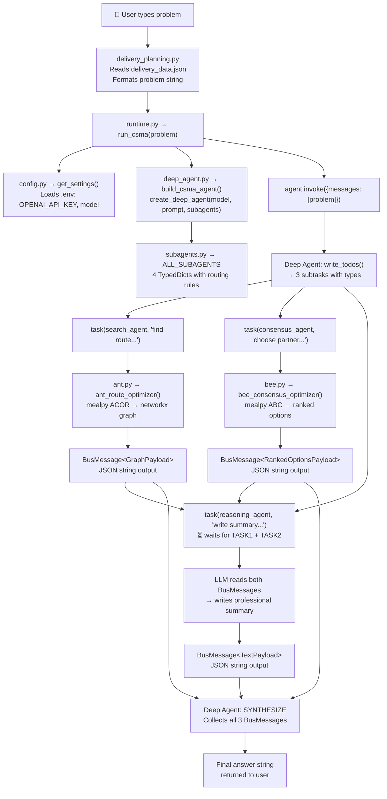

# CSMA — Complete System Walkthrough

> This document traces the **exact data flow** of a real problem through every file in the system — from the moment you type a problem to the moment you get an answer. Every function call, every JSON payload, every file handoff is documented.

---

## Table of Contents

1. [The Problem We're Solving](#1-the-problem-were-solving)
2. [Why Existing Tools Can't Solve It Alone](#2-why-existing-tools-cant-solve-it-alone)
3. [The Biological Insight](#3-the-biological-insight)
4. [Architecture Overview](#4-architecture-overview)
5. [Complete Data Flow — Step by Step](#5-complete-data-flow--step-by-step)
6. [Deep Dive: The Two Hand-Built Pieces](#6-deep-dive-the-two-hand-built-pieces)
7. [Deep Dive: The Species Tools](#7-deep-dive-the-species-tools)
8. [Deep Dive: The Orchestrator](#8-deep-dive-the-orchestrator)
9. [What's REUSED vs HAND-BUILT](#9-whats-reused-vs-hand-built)
10. [Test Architecture](#10-test-architecture)
11. [File Reference](#11-file-reference)

---

## 1. The Problem We're Solving

### The Core Challenge

Most multi-agent systems are **homogeneous** — every agent runs the same algorithm (usually just an LLM). But real-world problems are **heterogeneous**: a single business problem often contains subtasks that require fundamentally different computational strategies.

### Concrete Example: Delivery Planning

Take this problem from our demo ([delivery_data.json](file:///c:/Users/Nikshay/Documents/GitHub/Bio%20Inspired%20Swarm%20Agents/csma/examples/delivery_data.json)):

> *"Find the optimal delivery route across 6 Indian cities, choose the best shipping partner from DHL/FedEx/BlueDart, then write a client-facing summary."*

This **single** problem contains **three fundamentally different** subtask types:

| Subtask | What It Really Is | Best Algorithm |
|---------|-------------------|----------------|
| "Find the optimal route across 6 cities" | Traveling Salesman Problem (NP-hard combinatorial optimization) | Ant Colony Optimization — evolved for exactly this |
| "Choose the best shipping partner" | Multi-criteria decision under uncertainty | Bee Colony waggle-dance consensus — evolved for exactly this |
| "Write a client-facing summary" | Natural language generation | LLM — evolved for exactly this (well, trained) |

A pure-LLM multi-agent system would use GPT-4o for **all three**. It would hallucinate a "route" instead of mathematically optimizing one. It would guess a "best partner" instead of running proper weighted scoring. CSMA solves this by routing each subtask to the **biologically appropriate** algorithm.

### The Distance Matrix

The 6 cities and their inter-city distances (in km) from our data file:

```
              Mumbai     Delhi Bangalore   Chennai   Kolkata Hyderabad
    Mumbai         0      1400       980      1330      2050       710
     Delhi      1400         0      2150      2180      1530      1550
 Bangalore       980      2150         0       350      1870       570
   Chennai      1330      2180       350         0      1660       630
   Kolkata      2050      1530      1870      1660         0      1490
 Hyderabad       710      1550       570       630      1490         0
```

### The Shipping Partners

Three partners scored on four criteria:

| Partner | Cost | Reliability | Speed | Coverage |
|---------|------|-------------|-------|----------|
| DHL | 0.70 | 0.92 | 0.85 | 0.95 |
| FedEx | 0.60 | 0.95 | 0.90 | 0.88 |
| BlueDart | 0.85 | 0.80 | 0.75 | 0.70 |

With weights: cost=2.0, reliability=1.5, speed=1.0, coverage=0.5.

---

## 2. Why Existing Tools Can't Solve It Alone

| Tool | What It Does Well | What It Can't Do |
|------|-------------------|------------------|
| **LLM (GPT-4o)** | Language understanding, decomposition, synthesis | True mathematical optimization — it guesses routes, doesn't compute them |
| **mealpy (ACOR/ABC)** | Metaheuristic optimization | Understanding natural language, decomposing problems |
| **networkx** | Graph algorithms | Everything else |
| **deepagents** | Agent orchestration, subagent spawning | Doesn't know which algorithm suits which subtask |

**CSMA's contribution**: the glue that connects these. Specifically, two pieces:
1. **Ecosystem Bus** — a typed message format so LLM output and mealpy output can travel through the same channel
2. **Biological aptitude routing** — rules that say "this subtask looks like routing → send it to the ant"

---

## 3. The Biological Insight

Each species was chosen because evolution already solved the mapping:

| Abstract Problem Type | Biological Species | Why This Species |
|---|---|---|
| **Route finding** (TSP, shortest path) | 🐜 Ant | Ants evolved pheromone trails to find shortest paths between nest and food — this is literally ACO (Ant Colony Optimization) |
| **Network topology** (fault-tolerant infrastructure) | 🫠 Slime Mold | *Physarum polycephalum* grows network topologies that match the Tokyo rail system — Nature paper, 2010 |
| **Equal-weight consensus** (vendor selection) | 🐝 Bee | Honeybees use waggle dances to reach consensus on nest sites — each scout "votes" with dance intensity |
| **Authority-weighted consensus** | 🐺 Wolf | Grey wolf packs have strict alpha/beta/delta hierarchy affecting group decisions |
| **Experience-weighted consensus** | 🐘 Elephant | Elephant matriarchs use decades of accumulated experience to guide herd decisions |
| **Creative reasoning** | 🐦‍⬛ Crow | Crows are the only non-primate tool-makers — they solve novel multi-step problems |
| **Hub-and-arms parallel processing** | 🐙 Octopus | 2/3 of octopus neurons are in the arms — each arm has local intelligence, coordinated by a small central brain |
| **Leaderless swarm processing** | 🐦 Starling | Starling murmurations use purely local rules (3 neighbors) to achieve collective behavior |
| **Multi-headed feature processing** | 🦗 Mantis | Praying mantis has independent left/right visual processing with separate feature channels |

---

## 4. Architecture Overview



---

## 5. Complete Data Flow — Step by Step

### Step 0: User Runs the Demo

**File:** [examples/delivery_planning.py](file:///c:/Users/Nikshay/Documents/GitHub/Bio%20Inspired%20Swarm%20Agents/csma/examples/delivery_planning.py)

```bash
python examples/delivery_planning.py
```

The script does three things:

1. **Loads data** from [delivery_data.json](file:///c:/Users/Nikshay/Documents/GitHub/Bio%20Inspired%20Swarm%20Agents/csma/examples/delivery_data.json) (line 24-30) — reads cities, distance matrix, shipping partners, criteria
2. **Formats a problem string** (lines 37-67) — converts the raw JSON data into a natural-language problem description that includes the distance matrix as readable text, partners with their scores, and explicit requirements
3. **Calls `run_csma(problem)`** (line 78) — this is the single public API

The formatted problem string that gets passed to `run_csma()` looks like:

```
Find the optimal delivery route across these 6 cities, choose the best shipping
partner, then write a short client-facing summary.

Cities: Mumbai, Delhi, Bangalore, Chennai, Kolkata, Hyderabad

Distance Matrix (km):
              Mumbai     Delhi Bangalore   Chennai   Kolkata Hyderabad
    Mumbai         0      1400       980      1330      2050       710
     Delhi      1400         0      2150      2180      1530      1550
    ...

Shipping Partners:
  - DHL: cost=0.7, reliability=0.92, speed=0.85, coverage=0.95
  - FedEx: cost=0.6, reliability=0.95, speed=0.9, coverage=0.88
  - BlueDart: cost=0.85, reliability=0.8, speed=0.75, coverage=0.7

Evaluation Criteria: cost (weight=2.0), reliability (weight=1.5), ...

Requirements:
1. Find the shortest route visiting all cities (starting from Mumbai)
2. Choose the best shipping partner based on the criteria
3. Write a professional client-facing summary combining both results
```

---

### Step 1: Runtime Initialization

**File:** [csma/runtime.py](file:///c:/Users/Nikshay/Documents/GitHub/Bio%20Inspired%20Swarm%20Agents/csma/csma/runtime.py) → [run_csma()](file:///c:/Users/Nikshay/Documents/GitHub/Bio%20Inspired%20Swarm%20Agents/csma/csma/runtime.py#L18-L70)

```python
def run_csma(problem: str) -> str:
```

This function is the single public entrypoint. It does:

1. **`setup_logging()`** (line 35) → calls [config.py:setup_logging()](file:///c:/Users/Nikshay/Documents/GitHub/Bio%20Inspired%20Swarm%20Agents/csma/csma/config.py#L88-L95) → configures Python `logging` with the format `HH:MM:SS | module_name | LEVEL | message`
2. **`build_csma_agent()`** (line 41) → jumps to [deep_agent.py](file:///c:/Users/Nikshay/Documents/GitHub/Bio%20Inspired%20Swarm%20Agents/csma/csma/orchestrator/deep_agent.py) ← see Step 2
3. **`agent.invoke({...})`** (lines 44-46) → sends the problem to the Deep Agent as a LangChain message
4. **Extract answer** (lines 48-64) → reads the last `AIMessage` from the result. Handle both plain string content and structured content blocks `[{"type":"text","text":"..."}]` (discovered during testing that OpenAI returns the list format)

**Data entering this function:** `problem` is a plain Python string (the natural-language problem).  
**Data leaving this function:** `answer` is a plain Python string (the synthesized final answer).

---

### Step 2: Building the Agent

**File:** [csma/config.py](file:///c:/Users/Nikshay/Documents/GitHub/Bio%20Inspired%20Swarm%20Agents/csma/csma/config.py) → [Settings](file:///c:/Users/Nikshay/Documents/GitHub/Bio%20Inspired%20Swarm%20Agents/csma/csma/config.py#L17-L36)

When `get_settings()` is called (line 77 of deep_agent.py), pydantic-settings:
1. Reads [.env](file:///c:/Users/Nikshay/Documents/GitHub/Bio%20Inspired%20Swarm%20Agents/csma/.env) (configured at line 21)
2. Maps `OPENAI_API_KEY=sk-proj-...` → `settings.openai_api_key`
3. Maps `LLM_PROVIDER=openai` → `settings.llm_provider`
4. Maps `LLM_MODEL=gpt-4o` → `settings.llm_model`

Then [get_llm()](file:///c:/Users/Nikshay/Documents/GitHub/Bio%20Inspired%20Swarm%20Agents/csma/csma/config.py#L45-L85) creates a `ChatOpenAI(model="gpt-4o", temperature=0.1, api_key="sk-proj-...")` instance.

**File:** [csma/orchestrator/deep_agent.py](file:///c:/Users/Nikshay/Documents/GitHub/Bio%20Inspired%20Swarm%20Agents/csma/csma/orchestrator/deep_agent.py) → [build_csma_agent()](file:///c:/Users/Nikshay/Documents/GitHub/Bio%20Inspired%20Swarm%20Agents/csma/csma/orchestrator/deep_agent.py#L71-L93)

This function calls the `deepagents` library:

```python
agent = create_deep_agent(
    model="openai:gpt-4o",
    system_prompt=ORCHESTRATOR_PROMPT,   # 68-line prompt defining the workflow
    subagents=ALL_SUBAGENTS,             # 4 TypedDicts from subagents.py
)
```

`create_deep_agent()` is a **REUSED** library function. It automatically gives the agent:
- `write_todos` tool — for decomposing problems into subtasks
- `task` tool — for spawning subagents with context isolation
- `ls`, `read_file`, `write_file`, `execute` — filesystem tools (we don't use these)

The [ORCHESTRATOR_PROMPT](file:///c:/Users/Nikshay/Documents/GitHub/Bio%20Inspired%20Swarm%20Agents/csma/csma/orchestrator/deep_agent.py#L26-L68) tells the LLM exactly what to do:
1. DECOMPOSE with `write_todos` → label each subtask `[search]`, `[consensus]`, `[reasoning]`, or `[processing]`
2. DELEGATE with `task` → use `search_agent` for routing, `consensus_agent` for vendor selection, etc.
3. SYNTHESIZE → combine all BusMessage results into a coherent answer

---

### Step 3: Subagent Registration

**File:** [csma/orchestrator/subagents.py](file:///c:/Users/Nikshay/Documents/GitHub/Bio%20Inspired%20Swarm%20Agents/csma/csma/orchestrator/subagents.py)

This file defines **four subagents** as TypedDicts. Each has:
- `name` — how the orchestrator refers to it (e.g. `"search_agent"`)
- `description` — what the orchestrator reads to decide when to use it (class-level routing)
- `system_prompt` — contains the **species selection rules** (species-level routing)
- `tools` — the actual LangChain tools bound to this subagent

For example, [SEARCH_AGENT](file:///c:/Users/Nikshay/Documents/GitHub/Bio%20Inspired%20Swarm%20Agents/csma/csma/orchestrator/subagents.py#L28-L56):

```python
SEARCH_AGENT = {
    "name": "search_agent",
    "description": "Use for any task that searches a large solution space: "
                   "routing, scheduling, network design, graph optimization...",
    "system_prompt": """
        SPECIES SELECTION RULES:
        • SINGLE PATH or ROUTE → call ant_route_optimizer
        • NETWORK TOPOLOGY design → call slime_mold_network_optimizer
    """,
    "tools": [ant_route_optimizer, slime_mold_network_optimizer],
}
```

The **two-level routing** works like this:

```
Level 1 (CLASS ROUTING):
  Orchestrator LLM reads subagent descriptions →
  "This subtask is about routing" → delegates to search_agent

Level 2 (SPECIES ROUTING):
  search_agent LLM reads its system_prompt →
  "This is a single path problem" → calls ant_route_optimizer tool
```

This routing is **rule-based** (encoded in the prompts), not learned. Per the spec's guiding principle.

---

### Step 4: Problem Decomposition (Deep Agent)

When `agent.invoke()` is called, the Deep Agent LLM:

1. Reads the ORCHESTRATOR_PROMPT
2. Reads the user's problem
3. Calls `write_todos` to decompose it:

```
TODO List:
1. [search] Find the optimal route across 6 cities starting from Mumbai
   → delegate to: search_agent
   → depends on: nothing (independent)

2. [consensus] Choose the best shipping partner (DHL, FedEx, BlueDart)
   → delegate to: consensus_agent
   → depends on: nothing (independent)

3. [reasoning] Write a professional client-facing summary
   → delegate to: reasoning_agent
   → depends on: #1 and #2 (must wait for both results)
```

Subtasks #1 and #2 are **independent** — they can run in parallel.  
Subtask #3 **depends** on both — it must wait for the route and the partner decision.

---

### Step 5: Route Optimization (Ant Agent)

The Deep Agent calls: `task(agent="search_agent", task="Find the optimal route...")`

The `search_agent` subagent's LLM:
1. Reads its system_prompt (species selection rules)
2. Sees "find a single route" → matches the ant rule
3. Constructs a JSON input and calls `ant_route_optimizer`

**File:** [csma/species/ant.py](file:///c:/Users/Nikshay/Documents/GitHub/Bio%20Inspired%20Swarm%20Agents/csma/csma/species/ant.py) → [ant_route_optimizer()](file:///c:/Users/Nikshay/Documents/GitHub/Bio%20Inspired%20Swarm%20Agents/csma/csma/species/ant.py#L161-L224)

**Input** (what the search_agent LLM constructs and passes as `input_json`):
```json
{
    "subtask_id": "route-optimization",
    "nodes": ["Mumbai", "Delhi", "Bangalore", "Chennai", "Kolkata", "Hyderabad"],
    "distance_matrix": [
        [0, 1400, 980, 1330, 2050, 710],
        [1400, 0, 2150, 2180, 1530, 1550],
        [980, 2150, 0, 350, 1870, 570],
        [1330, 2180, 350, 0, 1660, 630],
        [2050, 1530, 1870, 1660, 0, 1490],
        [710, 1550, 570, 630, 1490, 0]
    ]
}
```

**Inside the function, the exact sequence is:**

1. **Parse JSON** (line 184): `data = json.loads(input_json)`

2. **Build networkx graph** (line 189): calls [_build_graph()](file:///c:/Users/Nikshay/Documents/GitHub/Bio%20Inspired%20Swarm%20Agents/csma/csma/species/ant.py#L26-L52)
   - Detects `distance_matrix` in the data (line 42)
   - Creates `nx.Graph()` and adds edges for every `i < j` pair where `matrix[i][j] > 0`
   - Result: a fully connected graph with 6 nodes and 15 edges, each with a `weight` attribute

3. **Choose method** (line 191): Since we have 6 nodes (> 3), it uses ACOR (line 195)

4. **Run ACOR optimization** (line 197): calls [_solve_with_acor()](file:///c:/Users/Nikshay/Documents/GitHub/Bio%20Inspired%20Swarm%20Agents/csma/csma/species/ant.py#L100-L158)
   - **Encoding trick** (lines 136-142): ACOR operates in continuous space `[0, 1]^n`, but TSP needs a permutation. We use **rank-order encoding**: the solution vector `[0.3, 0.8, 0.1, 0.6, 0.9, 0.5]` gets `argsort`'d to `[2, 0, 5, 3, 1, 4]`, which means visit nodes in order `[Bangalore, Mumbai, Hyderabad, Chennai, Delhi, Kolkata]`
   - **Objective function** (lines 136-142): sum of `dist(perm[k], perm[k+1])` for all consecutive pairs in the permutation
   - **mealpy setup** (lines 144-148):
     ```python
     problem_dict = {
         "bounds": FloatVar(lb=[0.0]*6, ub=[1.0]*6),  # 6 continuous variables
         "minmax": "min",                               # minimize total distance
         "obj_func": objective,                          # our cost function
     }
     ```
   - **Run optimizer** (lines 150-151):
     ```python
     model = OriginalACOR(epoch=100, pop_size=50)  # 50 ants, 100 generations
     model.solve(problem_dict, seed=42)
     ```
   - **Extract result** (lines 153-158):
     ```python
     best_perm = np.argsort(model.g_best.solution)  # decode permutation
     path = [nodes[int(i)] for i in best_perm]       # e.g. ["Mumbai", "Hyderabad", ...]
     total_cost = float(model.g_best.target.fitness)  # e.g. 4730.0
     ```

5. **Build path graph** (lines 202-207): creates a new `nx.Graph()` with only the edges in the solution path

6. **Convert to BusMessage** (lines 209-221):
   - Calls [to_payload()](file:///c:/Users/Nikshay/Documents/GitHub/Bio%20Inspired%20Swarm%20Agents/csma/csma/bus/translator.py#L33-L68) from translator.py (see Section 6)
   - Wraps in a `BusMessage` envelope with `source_agent="AntAgent"`, `agent_class=AgentClass.SEARCH`
   - Calls `msg.to_json()` → serialized JSON string

**Output** (returned as a string from the tool):
```json
{
    "message_id": "a1b2c3d4-...",
    "subtask_id": "route-optimization",
    "source_agent": "AntAgent",
    "agent_class": "search",
    "payload": {
        "type": "graph",
        "nodes": ["Mumbai", "Hyderabad", "Bangalore", "Chennai", "Kolkata", "Delhi"],
        "edges": [
            {"from": "Mumbai", "to": "Hyderabad", "weight": 710.0},
            {"from": "Hyderabad", "to": "Bangalore", "weight": 570.0},
            {"from": "Bangalore", "to": "Chennai", "weight": 350.0},
            {"from": "Chennai", "to": "Kolkata", "weight": 1660.0},
            {"from": "Kolkata", "to": "Delhi", "weight": 1530.0}
        ],
        "total_cost": 4820.0,
        "ordered_path": ["Mumbai", "Hyderabad", "Bangalore", "Chennai", "Kolkata", "Delhi"]
    },
    "timestamp": 1718373000.0,
    "meta": {}
}
```

This JSON string is the tool's return value. The `search_agent` subagent returns it unchanged to the orchestrator.

---

### Step 6: Partner Selection (Bee Agent)

**Running in parallel with Step 5.** The Deep Agent calls: `task(agent="consensus_agent", task="Choose the best shipping partner...")`

The `consensus_agent` subagent's LLM:
1. Reads its system_prompt
2. Sees "equal-weight options, no authority hierarchy" → matches the bee rule
3. Constructs JSON and calls `bee_consensus_optimizer`

**File:** [csma/species/bee.py](file:///c:/Users/Nikshay/Documents/GitHub/Bio%20Inspired%20Swarm%20Agents/csma/csma/species/bee.py) → [bee_consensus_optimizer()](file:///c:/Users/Nikshay/Documents/GitHub/Bio%20Inspired%20Swarm%20Agents/csma/csma/species/bee.py#L174-L247)

**Input:**
```json
{
    "subtask_id": "partner-selection",
    "options": [
        {"name": "DHL", "scores": {"cost": 0.7, "reliability": 0.92, "speed": 0.85, "coverage": 0.95}},
        {"name": "FedEx", "scores": {"cost": 0.6, "reliability": 0.95, "speed": 0.9, "coverage": 0.88}},
        {"name": "BlueDart", "scores": {"cost": 0.85, "reliability": 0.8, "speed": 0.75, "coverage": 0.7}}
    ],
    "criteria": [
        {"name": "cost", "weight": 2.0},
        {"name": "reliability", "weight": 1.5},
        {"name": "speed", "weight": 1.0},
        {"name": "coverage", "weight": 0.5}
    ]
}
```

**Inside the function, the exact sequence is:**

1. **Parse JSON + validate** (lines 204-220): Extracts options and criteria. If no criteria provided, infers from the first option's score keys.

2. **Compute base quality scores** (lines 108-127 of [_score_options_with_abc()](file:///c:/Users/Nikshay/Documents/GitHub/Bio%20Inspired%20Swarm%20Agents/csma/csma/species/bee.py#L82-L153)):
   - Normalize criteria weights: `[2.0, 1.5, 1.0, 0.5]` → `[0.4, 0.3, 0.2, 0.1]`
   - For each option, compute weighted quality:
     ```
     DHL:      0.7×0.4 + 0.92×0.3 + 0.85×0.2 + 0.95×0.1 = 0.821
     FedEx:    0.6×0.4 + 0.95×0.3 + 0.90×0.2 + 0.88×0.1 = 0.793
     BlueDart: 0.85×0.4 + 0.80×0.3 + 0.75×0.2 + 0.70×0.1 = 0.800
     ```
   - Build rationale strings from top criteria

3. **Run ABC optimization** (lines 129-153): The ABC fine-tunes the ranking:
   - [_build_quality_function()](file:///c:/Users/Nikshay/Documents/GitHub/Bio%20Inspired%20Swarm%20Agents/csma/csma/species/bee.py#L23-L79) creates an objective that maximizes the **gap** between the best and second-best option (so the winner is clearly separated)
   - Solution vector: 3 continuous variables in `[0, 1]`, one per option
   - Each variable acts as a small perturbation (0-10%) added to that option's base quality
   - ABC explores this space for 50 epochs with 30 bees
   - The best perturbation slightly adjusts scores to reflect exploration

4. **Compute quorum confidence** (lines 230-231): calls [_compute_quorum_confidence()](file:///c:/Users/Nikshay/Documents/GitHub/Bio%20Inspired%20Swarm%20Agents/csma/csma/species/bee.py#L156-L171)
   - Measures the gap between #1 and #2 scores
   - `confidence = min(gap/max_score * 2.0 + 0.5, 1.0)` — scaled so even small gaps give reasonable confidence

5. **Convert to BusMessage** (lines 233-247): Same pattern as the ant — `to_payload()` → `BusMessage` → `.to_json()`

**Output:**
```json
{
    "message_id": "e5f6g7h8-...",
    "subtask_id": "partner-selection",
    "source_agent": "BeeAgent",
    "agent_class": "consensus",
    "payload": {
        "type": "ranked",
        "options": [
            {"name": "DHL", "score": 0.891, "rationale": "coverage: 0.95, reliability: 0.92, speed: 0.85"},
            {"name": "BlueDart", "score": 0.860, "rationale": "cost: 0.85, reliability: 0.80, speed: 0.75"},
            {"name": "FedEx", "score": 0.843, "rationale": "reliability: 0.95, speed: 0.90, coverage: 0.88"}
        ],
        "winner": "DHL",
        "confidence": 0.93
    },
    "timestamp": 1718373001.0,
    "meta": {}
}
```

---

### Step 7: Summary Writing (Reasoning Agent)

**Waits for Steps 5 and 6 to complete.** The Deep Agent calls: `task(agent="reasoning_agent", task="Write a summary... [context: BusMessage from ant + BusMessage from bee]")`

The `reasoning_agent` reads the BusMessages from the ant and bee, and sees this is a "summarization" task (not creative under constraints), so it answers **directly** using its LLM (doesn't call the crow tool).

It produces a BusMessage with a TextPayload containing the professional summary, incorporating the specific route, cost, and partner winner from the other two results.

---

### Step 8: Synthesis

The Deep Agent's orchestrator LLM now has all three BusMessage results. Its ORCHESTRATOR_PROMPT tells it to:

> *"When all subtask results are collected (they will be BusMessage JSON strings), combine them into a single coherent final answer for the user."*

The LLM reads the GraphPayload (route + cost), RankedOptionsPayload (winner + confidence), and TextPayload (summary), and produces a final human-readable answer.

---

### Step 9: Answer Extraction

Back in [runtime.py](file:///c:/Users/Nikshay/Documents/GitHub/Bio%20Inspired%20Swarm%20Agents/csma/csma/runtime.py#L48-L64), the result is extracted:

```python
final_message = result["messages"][-1]  # Last AIMessage
raw_content = final_message.content     # Could be str or list[dict]

if isinstance(raw_content, list):
    # OpenAI returns [{"type": "text", "text": "..."}]
    parts = []
    for block in raw_content:
        if isinstance(block, dict) and block.get("type") == "text":
            parts.append(block["text"])
    answer = "\n".join(parts)
else:
    answer = str(raw_content)

return answer  # → back to delivery_planning.py → printed to console
```

---

## 6. Deep Dive: The Two Hand-Built Pieces

These are the **research contribution** — the only code that doesn't exist in any library.

### 6A. Ecosystem Bus: Schema

**File:** [csma/bus/schema.py](file:///c:/Users/Nikshay/Documents/GitHub/Bio%20Inspired%20Swarm%20Agents/csma/csma/bus/schema.py) (130 lines)

**Problem it solves:** mealpy returns a numpy array. networkx returns a Graph object. LLMs return strings. How do you send all of these through the same message channel?

**Solution:** A Pydantic v2 discriminated union with four payload types:

```python
Payload = Union[
    GraphPayload,          # Ant, SlimeMold → nodes + edges + path + cost
    RankedOptionsPayload,  # Bee, Wolf, Elephant → ranked list + winner + confidence
    TextPayload,           # Human, Crow → free-form text
    FeatureStreamsPayload,  # Octopus, Starling, Mantis → dict[str, list[float]]
]
```

Each payload has a `type` field used as the Pydantic discriminator:

```python
payload: Payload = Field(discriminator="type")  # line 118
```

This means `BusMessage.from_json(...)` automatically restores the **correct subclass** based on `{"type": "graph"}` vs `{"type": "ranked"}` etc.

The [BusMessage](file:///c:/Users/Nikshay/Documents/GitHub/Bio%20Inspired%20Swarm%20Agents/csma/csma/bus/schema.py#L107-L130) envelope wraps any payload with metadata:
- `message_id` — UUID, auto-generated
- `subtask_id` — links back to the orchestrator's todo list
- `source_agent` — which species tool produced this (e.g. "AntAgent")
- `agent_class` — which abstract class (search/consensus/reasoning/processing)
- `payload` — the discriminated union
- `timestamp` — auto-set
- `meta` — extensible dict for debug info

### 6B. Ecosystem Bus: Translator

**File:** [csma/bus/translator.py](file:///c:/Users/Nikshay/Documents/GitHub/Bio%20Inspired%20Swarm%20Agents/csma/csma/bus/translator.py) (212 lines)

**Problem it solves:** Two impedance mismatches:

1. **Library output → Payload** (`to_payload`): mealpy gives you `model.g_best.solution` (a numpy array) and `model.g_best.target.fitness` (a float). networkx gives you a `nx.Graph` object. These need to become typed `GraphPayload` or `RankedOptionsPayload` objects.

2. **Payload → LLM context** (`payload_to_context`): The synthesis LLM needs to read the results. A JSON blob is wasteful and loses readability. This function renders any payload as clean natural language.

**`to_payload()` example — GRAPH:**

```python
# Input: a networkx Graph with weight attributes
G = nx.Graph()
G.add_edge("Mumbai", "Delhi", weight=1400.0)

# Output: a GraphPayload Pydantic model
payload = to_payload(G, PayloadType.GRAPH, ordered_path=["Mumbai", "Delhi"])
# → GraphPayload(nodes=["Mumbai","Delhi"], edges=[{"from":"Mumbai","to":"Delhi","weight":1400.0}], ...)
```

Internally, [_graph_from_raw()](file:///c:/Users/Nikshay/Documents/GitHub/Bio%20Inspired%20Swarm%20Agents/csma/csma/bus/translator.py#L71-L103):
- Detects `isinstance(raw, nx.Graph)` → extracts nodes via `raw.nodes()`, edges via `raw.edges(data=True)`
- If `total_cost` not provided, sums all edge weights
- Constructs `GraphPayload(nodes=..., edges=..., total_cost=..., ordered_path=...)`

**`payload_to_context()` example — RANKED_OPTIONS:**

```python
# Input: a RankedOptionsPayload
payload = RankedOptionsPayload(
    options=[RankedOption(name="DHL", score=0.891, rationale="coverage: 0.95, ...")],
    winner="DHL", confidence=0.93
)

# Output: readable text
payload_to_context(payload)
# → "Decision Result (confidence: 93%)\n  Winner: DHL\n  Rankings:\n  1. DHL (score: 0.8910) — coverage: 0.95, ... ★ WINNER"
```

This is what the synthesis LLM actually reads when combining results.

---

## 7. Deep Dive: The Species Tools

Each species tool follows the exact same pattern:

```
Input: JSON string (from subagent LLM)
  ↓
Parse JSON
  ↓
Run algorithm (mealpy / networkx / LLM)
  ↓
to_payload(raw_result, PayloadType.XXX) → typed Payload
  ↓
BusMessage(payload=payload) → .to_json()
  ↓
Output: JSON string (returned to subagent)
```

### Phase 1 — Fully Implemented

| Species | File | Algorithm | Input Format | Output Payload |
|---------|------|-----------|-------------|----------------|
| 🐜 Ant | [ant.py](file:///c:/Users/Nikshay/Documents/GitHub/Bio%20Inspired%20Swarm%20Agents/csma/csma/species/ant.py) | `mealpy.swarm_based.ACOR.OriginalACOR` with rank-order encoding, fallback to greedy nearest-neighbor | `{nodes, edges|distance_matrix}` | `GraphPayload` with `ordered_path` |
| 🐝 Bee | [bee.py](file:///c:/Users/Nikshay/Documents/GitHub/Bio%20Inspired%20Swarm%20Agents/csma/csma/species/bee.py) | `mealpy.swarm_based.ABC.OriginalABC` with gap-maximizing objective | `{options[{name,scores}], criteria[{name,weight}]}` | `RankedOptionsPayload` with `winner`, `confidence` |

### Phase 2-3 — Stubs

| Species | File | Planned Algorithm | Status |
|---------|------|-------------------|--------|
| 🫠 SlimeMold | [slime_mold.py](file:///c:/Users/Nikshay/Documents/GitHub/Bio%20Inspired%20Swarm%20Agents/csma/csma/species/slime_mold.py) | Tero–Kobayashi–Nakagaki physarum flow on networkx | Stub → returns empty `GraphPayload` |
| 🐺 Wolf | [wolf.py](file:///c:/Users/Nikshay/Documents/GitHub/Bio%20Inspired%20Swarm%20Agents/csma/csma/species/wolf.py) | `mealpy.swarm_based.GWO.OriginalGWO` with authority weights | Stub |
| 🐘 Elephant | [elephant.py](file:///c:/Users/Nikshay/Documents/GitHub/Bio%20Inspired%20Swarm%20Agents/csma/csma/species/elephant.py) | `mealpy.swarm_based.EHO.OriginalEHO` with experience history | Stub |
| 🐦‍⬛ Crow | [crow.py](file:///c:/Users/Nikshay/Documents/GitHub/Bio%20Inspired%20Swarm%20Agents/csma/csma/species/crow.py) | `mealpy.swarm_based.CSA.OriginalCSA` + LLM rendering | Stub |
| 🐙 Octopus | [octopus.py](file:///c:/Users/Nikshay/Documents/GitHub/Bio%20Inspired%20Swarm%20Agents/csma/csma/species/octopus.py) | Async hub-and-arms coroutines | Stub |
| 🐦 Starling | [starling.py](file:///c:/Users/Nikshay/Documents/GitHub/Bio%20Inspired%20Swarm%20Agents/csma/csma/species/starling.py) | Boids-like local rules (3-neighbor) | Stub |
| 🦗 Mantis | [mantis.py](file:///c:/Users/Nikshay/Documents/GitHub/Bio%20Inspired%20Swarm%20Agents/csma/csma/species/mantis.py) | N parallel feature heads | Stub |

Every stub follows the same pattern: parse input, log a warning, return a placeholder BusMessage with the correct payload type but empty/default data.

---

## 8. Deep Dive: The Orchestrator

### The Two-Level Routing System

The routing happens in two stages, both encoded as natural-language rules in system prompts (not as a hand-coded router graph):

**Level 1 — Class Routing** (orchestrator → subagent):

The orchestrator's ORCHESTRATOR_PROMPT says:
```
- search_agent: routing, graph optimization, TSP
- consensus_agent: vendor/option selection, ranking  
- reasoning_agent: summaries, plans, creative text
- processing_agent: parallel feature streams
```

The `deepagents` library reads each subagent's `description` field to decide which one to delegate to. For example, `search_agent.description` says *"Use for any task that searches a large solution space: routing, scheduling, network design..."*

**Level 2 — Species Routing** (subagent → species tool):

Each subagent's `system_prompt` contains explicit rules. For example, `search_agent.system_prompt`:
```
SPECIES SELECTION RULES:
• If the task asks for a SINGLE PATH or ROUTE → call ant_route_optimizer
• If the task asks for NETWORK TOPOLOGY design → call slime_mold_network_optimizer
```

The subagent LLM reads this and picks the right tool.

### Why This Design?

Per the spec's guiding principle: *"Do not build orchestration from scratch."*

- We **don't** write a router graph or a classifier.
- We **don't** train a routing model.
- We let `deepagents`' existing delegation machinery do the routing.
- We **only** write the routing **rules** (as descriptions and prompts).

---

## 9. What's REUSED vs HAND-BUILT

| Component | Source | Lines of Config/Code |
|-----------|--------|---------------------|
| Problem decomposition (write_todos) | `deepagents` | 0 (built-in) |
| Subagent spawning (task tool) | `deepagents` | 0 (built-in) |
| Class-level routing | `deepagents` delegation + 4 description strings | ~20 lines |
| Species-level routing | LLM reads system_prompt rules | ~60 lines |
| Ant Colony Optimization | `mealpy.swarm_based.ACOR` | ~10 lines config |
| Artificial Bee Colony | `mealpy.swarm_based.ABC` | ~10 lines config |
| Graph algorithms | `networkx` | ~20 lines |
| LLM chat | `langchain_openai.ChatOpenAI` | 5 lines |
| **Ecosystem Bus: schema.py** | **HAND-BUILT** | **130 lines** |
| **Ecosystem Bus: translator.py** | **HAND-BUILT** | **212 lines** |
| **Species tool wrappers (ant.py, bee.py)** | **HAND-BUILT** (thin wrappers) | **~470 lines** |
| **Subagent definitions (routing rules)** | **HAND-BUILT** | **175 lines** |

The research contribution is specifically the **Ecosystem Bus** (schema + translator = 342 lines) — the typed message protocol that lets an ant colony's numpy array, a bee colony's ranked options, and an LLM's text all travel through the same channel without information loss.

---

## 10. Test Architecture

### Test Pyramid

```
                    ┌─────────────────┐
                    │  E2E + Live LLM │  1 test (calls OpenAI API)
                    │  test_end_to_end│  Validates full pipeline
                    └────────┬────────┘
                 ┌───────────┴───────────┐
                 │  Integration Tests    │  2 tests
                 │  test_end_to_end      │  ant+bee interop, render context
                 └───────────┬───────────┘
          ┌──────────────────┴──────────────────┐
          │         Species Tool Tests          │  9 tests
          │  test_ant_tool + test_bee_tool       │  Tool I/O, round-trip, edge cases
          └──────────────────┬──────────────────┘
    ┌────────────────────────┴────────────────────────┐
    │              Bus Unit Tests                     │  24 tests
    │  test_bus_schema + test_translator              │  Round-trip, all payload types
    └─────────────────────────────────────────────────┘
```

### What Each Test File Validates

| File | Tests | What It Proves |
|------|-------|----------------|
| [test_bus_schema.py](file:///c:/Users/Nikshay/Documents/GitHub/Bio%20Inspired%20Swarm%20Agents/csma/tests/test_bus_schema.py) | 12 | BusMessage round-trip (`to_json()` → `from_json()`) for all 4 payload types; edge cases (None path, empty edges, empty streams, auto-generated UUID/timestamp, meta preservation) |
| [test_translator.py](file:///c:/Users/Nikshay/Documents/GitHub/Bio%20Inspired%20Swarm%20Agents/csma/tests/test_translator.py) | 12 | `to_payload()` from networkx Graph, from dict, with auto-cost; `_ranked_from_raw()` sorting, empty-list error; `payload_to_context()` readable output for all types |
| [test_ant_tool.py](file:///c:/Users/Nikshay/Documents/GitHub/Bio%20Inspired%20Swarm%20Agents/csma/tests/test_ant_tool.py) | 4 | Small graph (nearest-neighbor), distance matrix input, ACOR optimization (4+ nodes), JSON round-trip |
| [test_bee_tool.py](file:///c:/Users/Nikshay/Documents/GitHub/Bio%20Inspired%20Swarm%20Agents/csma/tests/test_bee_tool.py) | 5 | Basic ranking, 2-option edge case, descending sort, default criteria inference, JSON round-trip |
| [test_end_to_end.py](file:///c:/Users/Nikshay/Documents/GitHub/Bio%20Inspired%20Swarm%20Agents/csma/tests/test_end_to_end.py) | 3 | ant+bee produce compatible BusMessages; `render_bus_messages_context()` combines them; **full pipeline with live OpenAI API** |

---

## 11. File Reference

### Complete Project Tree

```
csma/
├── .env                          # Live config (gitignored) — OPENAI_API_KEY
├── .env.example                  # Template for new developers
├── .gitignore                    # Protects .env, __pycache__, etc.
├── pyproject.toml                # Package metadata, deps, pytest config
├── requirements.txt              # Flat pip list (alternative to pyproject.toml)
├── README.md                     # Quick start, architecture, species taxonomy
│
├── csma/                         # Main package
│   ├── __init__.py
│   ├── config.py                 # Settings (pydantic-settings), get_llm(), setup_logging()
│   ├── runtime.py                # run_csma() — THE public entrypoint
│   │
│   ├── bus/                      # ★ HAND-BUILT: Ecosystem Bus
│   │   ├── __init__.py
│   │   ├── schema.py             # BusMessage, 4 Payload types, discriminated union
│   │   └── translator.py         # to_payload(), payload_to_context()
│   │
│   ├── species/                  # One file per biological species
│   │   ├── __init__.py
│   │   ├── ant.py                # ✅ mealpy ACOR → GraphPayload
│   │   ├── bee.py                # ✅ mealpy ABC → RankedOptionsPayload
│   │   ├── slime_mold.py         # 🔲 Stub
│   │   ├── wolf.py               # 🔲 Stub
│   │   ├── elephant.py           # 🔲 Stub
│   │   ├── crow.py               # 🔲 Stub
│   │   ├── octopus.py            # 🔲 Stub
│   │   ├── starling.py           # 🔲 Stub
│   │   └── mantis.py             # 🔲 Stub
│   │
│   └── orchestrator/             # Agent assembly (mostly REUSED config)
│       ├── __init__.py
│       ├── subagents.py          # 4 subagent defs with routing rules
│       └── deep_agent.py         # build_csma_agent(), render_bus_messages_context()
│
├── examples/
│   ├── delivery_data.json        # Problem data (6 cities, 3 partners)
│   └── delivery_planning.py      # Demo script → run_csma()
│
└── tests/
    ├── __init__.py
    ├── conftest.py               # Loads .env for pytest
    ├── test_bus_schema.py        # 12 tests — payload round-trips
    ├── test_translator.py        # 12 tests — to_payload + payload_to_context
    ├── test_ant_tool.py          # 4 tests — ACOR + nearest-neighbor
    ├── test_bee_tool.py          # 5 tests — ABC ranking
    └── test_end_to_end.py        # 3 tests — integration + live LLM
```

### Data Flow Summary Diagram

```
delivery_data.json ──→ delivery_planning.py ──→ runtime.py::run_csma()
                            │                       │
                            │ reads JSON,            │ calls setup_logging()
                            │ formats problem        │ calls build_csma_agent()
                            │ string                 │ calls agent.invoke()
                            │                       │
                            │                  config.py
                            │                   │ .env → Settings
                            │                   │ → ChatOpenAI(gpt-4o)
                            │                       │
                            │              deep_agent.py::build_csma_agent()
                            │                   │ create_deep_agent(
                            │                   │   model, prompt, subagents
                            │                   │ )
                            │                       │
                            │              subagents.py::ALL_SUBAGENTS
                            │                   │ 4 TypedDicts with routing rules
                            │                       │
                            ▼                       ▼
                      Deep Agent LLM (orchestrator)
                            │
                    write_todos() → decompose
                            │
               ┌────────────┼────────────┐
               │            │            │
          task(search)  task(consensus)  task(reasoning)
               │            │            │ (waits for ↙↓)
               │            │            │
          search_agent  consensus_agent  reasoning_agent
          (subagent LLM) (subagent LLM) (subagent LLM)
               │            │            │
          reads rules   reads rules   reads rules
          → pick ant    → pick bee    → answer directly
               │            │            │
          ant.py        bee.py        LLM generates
               │            │         TextPayload
          _build_graph  _score_options_with_abc
          _solve_with_  _build_quality_function
           acor()        _compute_quorum_confidence
               │            │            │
          to_payload()  to_payload()     │
          (translator)  (translator)     │
               │            │            │
          BusMessage    BusMessage    BusMessage
          <Graph>       <Ranked>     <Text>
               │            │            │
               └────────────┼────────────┘
                            │
                    Deep Agent SYNTHESIZE
                            │
                    Final answer string
                            │
                    runtime.py extracts content
                            │
                    delivery_planning.py prints
```
